<div align="center">
<a href="https://weftos.weavelogic.ai">
<picture>
  <source media="(prefers-color-scheme: dark)" srcset="assets/banner-dark.svg">
  
</picture>
</a>

[](https://github.com/WeftOS/weftos/releases)
[](https://crates.io/crates/weftos)
[](https://weftos.weavelogic.ai)
[](https://github.com/WeftOS/weftos/blob/master/LICENSE)
</div>

WeftOS is an agent framework plus a cognitive OS layer, written in Rust. The framework gives you LLM providers,
channels, tools, skills and the `weft` agent CLI. The OS layer is a kernel with a process table, typed IPC, an
append-only audit chain and constitutional governance. On top sit a machine mesh, governed workload placement, and
cogs: small signed programs that run as workloads on the mesh. The operator CLI is `weaver`.

## What is inside

Each link goes to the docs page, which states the status of its decision record and what is built.

| | | |
|---|---|---|
| **[Cogs](https://weftos.weavelogic.ai/docs/weftos/platform/cogs)**<br>Signed, governed workloads run by the Cog Host.<br>*Accepted* | **[Cogbus](https://weftos.weavelogic.ai/docs/weftos/platform/cogbus)**<br>The cog data plane in the node daemon.<br>*Accepted, built* | **[Governed placement](https://weftos.weavelogic.ai/docs/weftos/platform/placement)**<br>Which node runs a workload, gated and recorded.<br>*Accepted* |
| **[Mesh](https://weftos.weavelogic.ai/docs/weftos/mesh-networking)**<br>Encrypted peer-to-peer links, admission, cross-node IPC.<br>*Built in the 0.8.4 daemon* | **[Exposures](https://weftos.weavelogic.ai/docs/weftos/platform/exposures)**<br>What a node offers the mesh, with a local kill switch.<br>*Proposed, partly built* | **[Router](https://weftos.weavelogic.ai/docs/weftos/platform/tailnet-router)**<br>One HTTPS front door per development machine.<br>*Proposed, partly built* |
| **[Chief of staff](https://weftos.weavelogic.ai/docs/weftos/platform/chief-of-staff)**<br>An agent host with a conversation API and MCP server.<br>*Proposed, partly built* | **[AI org](https://weftos.weavelogic.ai/docs/weftos/platform/ai-org)**<br>A versioned agent catalog and agent teams.<br>*Accepted* | **[Licence](https://weftos.weavelogic.ai/docs/weftos/platform/licence-proxy)**<br>A Cognitum Seed as the licence proxy for one mesh.<br>*Proposed, partly built* |
| **[Voice](https://weftos.weavelogic.ai/docs/weftos/platform/voice)**<br>Speech to text, agent brain, text to speech.<br>*Accepted, one record Proposed* | **[Update and signing](https://weftos.weavelogic.ai/docs/weftos/platform/update-and-signing)**<br>`weaver update` fails closed on an unverified release.<br>*Shipped* | **[Platform overview](https://weftos.weavelogic.ai/docs/weftos/platform)**<br>Every page with its record and status.<br>*Index* |

## Repositories

| Repository | What it holds |
|---|---|
| [WeftOS/weftos](https://github.com/WeftOS/weftos) | The OS, the kernel, the agent framework, the `weft` and `weaver` CLIs, and the documentation site. |
| [WeftOS/weftos-cogs](https://github.com/WeftOS/weftos-cogs) | Signed cogs, the cog repository tooling, and the hardware catalog. |

## By the numbers

<!-- facts:start -->
- Release [v0.8.4](https://github.com/WeftOS/weftos/releases/tag/v0.8.4)
- 65 workspace crates, 40 of them published to [crates.io](https://crates.io/crates/weftos)
- 123 architecture decision records
- 34 `weaver` and 29 `weft` top-level commands
- 29 cogs in [WeftOS/weftos-cogs](https://github.com/WeftOS/weftos-cogs) (v0.1.4), and 795 modules and 312 chips in the hardware catalog
<!-- facts:end -->

## Quick install

Each route installs `weft` (agent CLI) and `weaver` (operator CLI).

```sh
curl -fsSL https://raw.githubusercontent.com/WeftOS/weftos/master/scripts/install.sh | sh
brew install weave-logic-ai/tap/clawft-cli weave-logic-ai/tap/clawft-weave
docker pull ghcr.io/weftos/weftos:latest
```

The [installation guide](https://weftos.weavelogic.ai/docs/weftos/getting-started/installation) lists every platform.

---

<sub>Built by [WeaveLogic](https://weavelogic.ai). Licensed MIT or Apache-2.0. The numbers above are refreshed daily and on each release from [weftos.weavelogic.ai/facts.json](https://weftos.weavelogic.ai/facts.json).</sub>
